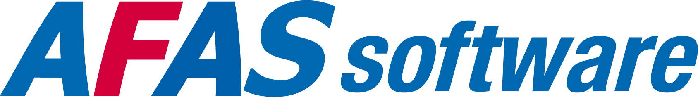

# HelloID-Conn-Prov-Target-AFAS-Profit-Employees

> [!IMPORTANT]
> This repository contains the connector and configuration code only. The implementer is responsible to acquire the connection details such as username, password, certificate, etc. You might even need to sign a contract or agreement with the supplier before implementing this connector. Please contact the client's application manager to coordinate the connector requirements.

<p align="center">
  
</p>

## Table of contents

- [HelloID-Conn-Prov-Target-AFAS-Profit-Employees](#helloid-conn-prov-target-afas-profit-employees)
  - [Table of contents](#table-of-contents)
  - [Introduction](#introduction)
  - [Supported features](#supported-features)
  - [Getting started](#getting-started)
    - [HelloID Icon URL](#helloid-icon-url)
    - [Requirements](#requirements)
    - [Connection settings](#connection-settings)
      - [Scope](#scope)
    - [Correlation configuration](#correlation-configuration)
    - [Field mapping](#field-mapping)
    - [Account Reference](#account-reference)
  - [Remarks](#remarks)
    - [Create](#create)
    - [Update](#update)
    - [Delete](#delete)
    - [Adding fields](#adding-fields)
    - [Free fields](#free-fields)
  - [Development resources](#development-resources)
    - [API endpoints](#api-endpoints)
    - [API documentation](#api-documentation)
  - [Getting help](#getting-help)
  - [HelloID docs](#helloid-docs)

## Introduction

_HelloID-Conn-Prov-Target-AFAS-Profit-Employees_ is a _target_ connector. _AFAS-Profit-Employees_ provides an interface to communicate with Profit through a set of GetConnectors, which is a component that allows the creation of custom views on the Profit data. GetConnectors are based on a pre-defined `'data collection'`, which is an existing view based on the data inside the Profit database.

## Supported features

The following features are available:

| Feature                                   | Supported | Actions                | Remarks           |
|-------------------------------------------|-----------|------------------------|-------------------|
| **Account Lifecycle**                     | ✅         | Create, Update, Delete | Correlation only  |
| **Permissions**                           | ❌         | -                      |                   |
| **Resources**                             | ❌         | -                      |                   |
| **Entitlement Import: Accounts**          | ✅         | -                      |                   |
| **Entitlement Import: Permissions**       | ❌         | -                      |                   |
| **Governance Reconciliation Resolutions** | ✅         | Delete                 | See `DeleteMode`  |

## Getting started

By using this connector you will have the ability to update employees in the AFAS Profit system, for example to write back the work email address.

Connecting to Profit is done using the app connector system with OAuth client credentials. Please see the following pages from the AFAS Knowledge Base for more information.

[Create the APP connector](https://help.afas.nl/help/NL/SE/App_Apps_Custom_Add.htm)

[Manage the APP connector](https://help.afas.nl/help/NL/SE/App_Apps_Custom_Maint.htm)

[Configure OAuth on the APP connector](https://help.afas.nl/help/NL/SE/120718.htm#o136210)

### HelloID Icon URL

URL of the icon used for the HelloID Provisioning target system.

```
https://raw.githubusercontent.com/Tools4everBV/HelloID-Conn-Prov-Target-AFAS-Profit-Employees/refs/heads/main/Icon.png
```

### Requirements

- HelloID Provisioning agent (cloud or on-prem).
- Loaded and available AFAS GetConnector `T4E_HelloID_Target_Employees`.
- In addition to the above GetConnector, the connector also uses the following built-in Profit update-connector:
  - KnEmployee
- AFAS App Connector with access to the GetConnector and associated views.
  - OAuth client id
  - OAuth client secret

> [!TIP]
> For this connector we have created a default GetConnector [Tools4ever - HelloID - T4E_HelloID_Target_Employees.gcn], which can be imported directly into the AFAS Profit environment.

The field ids of the GetConnector are equal to the AFAS field codes of `KnEmployee` / `KnPerson`. This allows the scripts to compare the field mapping with AFAS without a translation table.

| Field id    | AFAS description    | Usage                                       |
|-------------|---------------------|---------------------------------------------|
| EmId        | Medewerker          | Correlation and account reference           |
| BcCo        | Persoonsnummer      | Match of the person in the update payload   |
| Nm          | Naam                | Display name in the account import          |
| EmAd        | E-mail werk         | Mappable                                    |
| EmailPortal | E-mail toegang      | Mappable                                    |
| TeNr        | Telefoonnr. werk    | Mappable                                    |
| MbNr        | Mobiel werk         | Mappable                                    |

> [!IMPORTANT]
> The GetConnector must return a single row per employee. When multiple rows are returned for the same `EmId`, the update and delete actions fail.

### Connection settings

The following settings are required to connect to the API.

| Setting                                            | Description                                                                                                                         | Mandatory |
|----------------------------------------------------|-------------------------------------------------------------------------------------------------------------------------------------|-----------|
| Base Uri                                           | The URL to the AFAS environment REST services                                                                                       | Yes       |
| Client ID                                          | The OAuth client id of the AppConnector                                                                                             | Yes       |
| Client Secret                                      | The OAuth client secret of the AppConnector                                                                                         | Yes       |
| GetConnector                                       | The GetConnector in AFAS to query the employee with                                                                                 | Yes       |
| UpdateConnector                                    | The UpdateConnector in AFAS to update the employee with                                                                             | Yes       |
| Behavior on delete during a reconciliation action  | Only applies when delete is triggered by reconciliation, when no field mapping data is available. `keepEmAd` (default) or `clearEmAd` | Yes       |

#### Scope

The data collection retrieved by the GetConnector is sufficient for HelloID to provision persons. The data collection can be changed by the customer itself to meet their requirements.

| Connector                                              | Field               | Default filter            |
|--------------------------------------------------------|---------------------|---------------------------|
| __Tools4ever - HelloID - T4E_HelloID_Target_Employees__ | contract start date | <[Vandaag + 3 maanden]    |
|                                                        | contract end date   | >[Vandaag - 3 maanden];[] |

### Correlation configuration

The correlation configuration is used to specify which properties will be used to match an existing account within _AFAS Profit_ to a person in _HelloID_.

| Setting                   | Value                             |
|---------------------------|-----------------------------------|
| Enable correlation        | `True`                            |
| Person correlation field  | `PersonContext.Person.ExternalId` |
| Account correlation field | `EmId`                            |

> [!TIP]
> _For more information on correlation, please refer to our correlation [documentation](https://docs.helloid.com/en/provisioning/target-systems/powershell-v2-target-systems/correlation.html) pages_.

### Field mapping

The field mapping can be imported by using the [_fieldMapping.json_](./fieldMapping.json) file.

| Field | Actions                | Description                                                                 |
|-------|------------------------|-----------------------------------------------------------------------------|
| EmId  | Create                 | Correlation on employee number                                              |
| BcCo  | Create, Update         | Person number, filled by the scripts from AFAS. Never updated               |
| EmAd  | Create, Update, Delete | Work email address. Cleared on delete, as it has to be unique within AFAS   |

### Account Reference

The account reference is populated with the `EmId` property (employee number) from _AFAS Profit_. The `BcCo` property (person number) is retrieved from AFAS in every action and is used to match the person in the update payload.

## Remarks

> [!IMPORTANT]
> This version (5.x) is intended for new implementations only. The account reference, GetConnector, field mapping and configuration are not compatible with version 4.x and earlier.

> [!IMPORTANT]
> In view of GDPR, the persons private data, such as private email address and birthdate are not in the data collection by default. When needed for the implementation (e.g. set emailaddress with private email address on delete), these properties will have to be added.

> [!IMPORTANT]
> We never create or delete employees in AFAS. The connector only correlates existing employees and updates the mapped fields.

### Create

The create action only correlates. It searches the employee on `EmId` with a non-empty `BcCo`. When no employee or multiple employees are found, the action fails. The create action does not write to AFAS; HelloID performs an update directly after correlation.

### Update

The update action only sends the changed fields. An empty (`""`) or `null` mapped value clears the field in AFAS. Mapped fields that are not available in the GetConnector cannot be compared and are skipped.

### Delete

The delete action writes all fields of the delete mapping (by default an empty `EmAd`), including empty values, so fields can be cleared. When the employee is not found, the action is treated as successful.

During reconciliation no field mapping data is available. The configuration setting `DeleteMode` determines the behavior:

| Value       | Behavior                                         |
|-------------|--------------------------------------------------|
| `keepEmAd`  | No changes in AFAS, only uncorrelate (default)   |
| `clearEmAd` | Clear the work email address (`EmAd`)            |

### Adding fields

To update an additional field, for example `TeNr`:

1. Add the field to the GetConnector with the AFAS field code as field id (e.g. `TeNr`).
2. Add the field to the field mapping with the same name.

No script changes are needed. Fields are written to `KnPerson`.

### Free fields

Free fields on the employee (field code `U` followed by a GUID, e.g. `U4F2A9C0E1B7D4E3A8F6C5B2D1E0A9F8C`) are recognized by their name and written to the `AfasEmployee` element instead of `KnPerson`. Add them to the GetConnector and field mapping in the same way as described above.

> [!NOTE]
> Free fields on the person (`KnPerson`) are not supported out of the box, as they are also written to the `AfasEmployee` element. This requires a custom change.

For more information about updating a free field, please check the [AFAS documentation](https://help.afas.nl/help/NL/SE/App_Cnnctr_Update_050.htm).

## Development resources

### API endpoints

The following endpoints are used by the connector.

| Endpoint                      | HTTP Method | Description                   |
|-------------------------------|-------------|-------------------------------|
| profitrestservices/oauth/token | POST       | Retrieve an OAuth access token |
| profitrestservices/connectors | GET         | Retrieve employee information |
| profitrestservices/connectors | PUT         | Update employee information   |

### API documentation

[AFAS App Connector documentation](https://help.afas.nl/help/NL/SE/App_Apps_Custom_Add.htm)

[KnEmployee update connector](https://help.afas.nl/help/NL/SE/App_Conect_UpdDsc_KnEmployee.htm)

## Getting help

> [!TIP]
> _For more information on how to configure a HelloID PowerShell connector, please refer to our [documentation](https://docs.helloid.com/en/provisioning/target-systems/powershell-v2-target-systems.html) pages_.

> [!TIP]
> _If you need help, feel free to ask questions on our [forum](https://forum.helloid.com)_.

## HelloID docs

The official HelloID documentation can be found at: https://docs.helloid.com/
